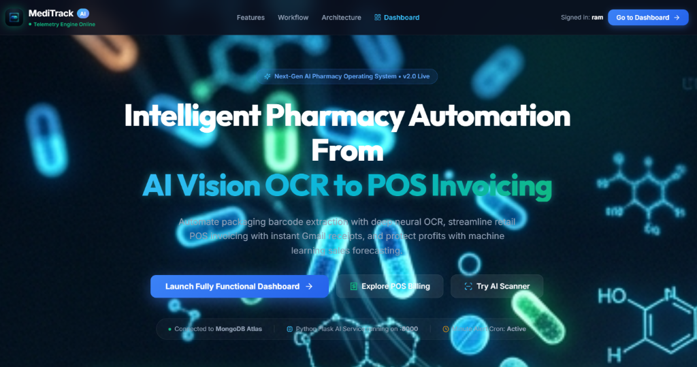
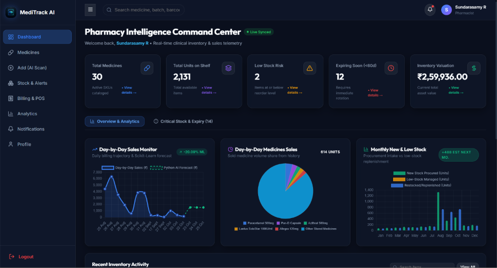

# 💊 MediTrack AI — Next-Gen AI Pharmacy Automation Operating System

[](https://react.dev/)
[](https://nodejs.org/)
[](https://flask.palletsprojects.com/)
[](https://www.mongodb.com/atlas)
[](https://firebase.google.com/)
[](https://opencv.org/)
[](https://scikit-learn.org/)

> **MediTrack AI** is an enterprise-grade, full-stack pharmacy intelligence and automation platform. Built with a modern microservices architecture, it bridges deep neural AI vision OCR for medicine packaging extraction, real-time retail Point-of-Sale (POS) invoicing with instant Gmail receipts, machine learning sales demand forecasting, and multi-channel proactive alerting across Email, WhatsApp, and Cloud Firestore.

---

## 📸 Output & Application Showcase

### 1. Modern Medicine-Themed AI Landing Page
The entry point features an interactive cyber-clinical glassmorphic interface, real-time microservice telemetry badges, and one-click access to the command center and AI scanner.



- **Telemetry Engine Status**: Real-time connection indicators for **MongoDB Atlas**, **Python Flask AI Service (:8000)**, and the **Minute Alert Cron Engine**.
- **Modern Clinical Aesthetics**: Glowing molecular and capsule background visuals with custom emerald and cyan neon accents.
- **Quick-Action Navigation**: Seamless routing to the Command Center Dashboard, POS Billing, and AI Packaging Scanner.

---

### 2. Pharmacy Intelligence Command Center (Live Synced Dashboard)
A unified operational hub providing pharmacists and administrators with actionable inventory intelligence, live financial metrics, and machine-learning-driven sales forecasts.



#### Key Telemetry & Insights Displayed:
- **Real-Time Clinical Inventory Metrics**:
  - 📦 **Total Medicines**: 30 Active SKUs cataloged in system.
  - 🔢 **Total Units on Shelf**: 2,131 available units across all batches.
  - ⚠️ **Low Stock Risk**: 2 critical items at or below minimum reorder thresholds.
  - ⏳ **Expiring Soon (<60d)**: 12 batches requiring immediate stock rotation.
  - 💰 **Live Inventory Valuation**: **₹2,59,936.00** total inventory asset value in INR.
- **Predictive Analytics & Visualizations**:
  - 📈 **Day-by-Day Sales Monitor**: Historical revenue curves paired with a **Scikit-Learn Linear Regression AI Demand Forecast**.
  - 🥧 **Medicine Volume Share**: Interactive pie chart analyzing high-velocity products (Paracetamol 500mg, Pan-D, Azithral, Lantus SoloStar, Allegra, etc.).
  - 📊 **Monthly Stock Replenishment Intake**: Dual-series comparison of new inventory procurement versus low-stock replenishment (+488 estimated for next month).
  - 🕒 **Recent Inventory Activity**: Live audit trail recording stock adjustments, new batch arrivals, and billing updates.

---

## 🌟 Core System Features

### 👁️ Deep Neural AI Vision OCR & Smart Barcode Recognition
- **Computer Vision Preprocessing**: Utilizes OpenCV for adaptive thresholding, bilateral noise filtering, and perspective correction.
- **Packaging Text Extraction**: EasyOCR deep learning neural networks automatically extract brand names, active pharmaceutical ingredients (APIs), batch numbers, manufacturing dates, and expiration dates directly from medicine strips or packaging boxes.
- **Hardware & Web Camera Barcode Scanning**: PyZBar integration for instant UPC/EAN barcode and QR decoding to rapidly load SKU metadata without manual data entry.

### 🧾 Point-of-Sale (POS) Retail Billing & Smart Invoicing
- **Rapid Item Scanning**: Search medicines by name, SKU, or barcode to add directly into the POS cart with dynamic stock limit validations.
- **Automated Stock Decrement**: Safely reserves and decrements units from the active inventory upon checkout completion.
- **Dynamic Taxes & Discounts**: Granular GST tax rate configuration and discount handling.
- **Instant Digital Gmail Receipts**: Generates unique invoice numbers (`INV-YYYY-XXXXX`) and dispatches formatted, branded email invoices to customers via Nodemailer.
- **PDF & Thermal Print Support**: Standardized printable receipt layouts for counter printers.

### 📈 Scikit-Learn Predictive Analytics & Risk Modeling
- **Sales Demand Forecasting**: Supervised linear regression algorithms analyze daily sales trends to project future inventory consumption rates.
- **Stockout Risk Probability**: Calculates run-out velocity based on current shelf stock and historical daily consumption to trigger preemptive reorder recommendations.
- **Expiry Risk Grading**: Flags batches nearing expiry dates relative to current inventory turnover velocity to eliminate financial write-offs.

### 🔔 Multi-Channel Proactive Alerting System
- **Precision Cron Engine**: Configurable scheduled cron jobs (`node-cron`) run regular health and threshold scans without blocking the API thread.
- **Automated Email Notifications**: SMTP-backed alerts warn store managers of expiring batches and low inventory.
- **WhatsApp Bot Alerts**: Integration with Meta WhatsApp Cloud API / Twilio / CallMeBot for mobile delivery of critical inventory emergencies.
- **Firestore Real-Time Stream**: Pushes sub-second alerts directly to the in-app notification center.

### 🛡️ Role-Based Clinical Security & Authentication
- **Dual-Layer Auth**: Client-side Firebase Authentication coupled with verified server-side JWT / Firebase Admin tokens.
- **Granular Role Hierarchy**:
  - `Pharmacist`: Inventory cataloging, scanning, POS billing, and customer receipt generation.
  - `Chief Chemist`: Expiry risk audits, stock adjustments, batch verification, and supplier purchase orders.
  - `Pharmacy Admin`: Global system settings, user credential governance, pricing controls, and financial analytics.

---

## 🏗️ System Architecture

MediTrack AI utilizes a distributed, resilient three-tier microservices architecture:

```text
                               ┌──────────────────────────────────────────┐
                               │         React 18 + Vite Frontend         │
                               │  (Glassmorphic Dark UI + Chart.js Graphs) │
                               └────────────────────┬─────────────────────┘
                                                    │
                                                    ▼
                               ┌──────────────────────────────────────────┐
                               │           Firebase Authentication        │
                               │        (Secure Identity & Bearer Token)  │
                               └────────────────────┬─────────────────────┘
                                                    │
                                                    ▼
                               ┌──────────────────────────────────────────┐
                               │          Node.js + Express Backend       │
                               │          (Central Business API Hub)       │
                               └───┬─────────────────┬──────────────────┬─┘
                                   │                 │                  │
         ┌─────────────────────────┘                 │                  └─────────────────────────┐
         ▼                                           ▼                                            ▼
┌──────────────────┐                       ┌──────────────────┐                         ┌──────────────────┐
│  MongoDB Atlas   │                       │ Firebase Cloud   │                         │  Python Flask    │
│  (Mongoose ORM)  │                       │    Firestore     │                         │  AI Microservice │
│                  │                       │                  │                         │  (Port :8000)    │
│ • Users & Roles  │                       │ • Real-time      │                         │                  │
│ • Medicines/SKUs │                       │   Notifications  │                         │ • OpenCV Vision  │
│ • Sales & Invoices│                      │ • User Activity  │                         │ • EasyOCR Engine │
│ • Purchases      │                       │   Audit Logs     │                         │ • PyZBar Barcode │
│ • Suppliers      │                       │                  │                         │ • Scikit-Learn ML│
└──────────────────┘                       └──────────────────┘                         └──────────────────┘
```

---

## 🛠️ Technology Stack

| Domain | Technologies & Libraries |
| :--- | :--- |
| **Frontend UI** | React 18, Vite 6, React Router DOM v7, Chart.js, React-Chartjs-2, Lucide React, Custom Dark Glassmorphism CSS |
| **Backend API** | Node.js, Express.js, Mongoose ODM, Firebase Admin SDK, Nodemailer, Node-Cron, Multer, Axios, Cors |
| **AI & Machine Learning** | Python 3, Flask, OpenCV (opencv-python-headless), EasyOCR, PyZBar, Scikit-Learn, NumPy, Pillow |
| **Cloud Databases** | **MongoDB Atlas** (Primary persistence) & **Google Cloud Firestore** (Real-time pub/sub notifications) |
| **Authentication** | Firebase Client SDK + Firebase Admin Token Verification + MongoDB User Profile Synchronization |
| **Messaging & Notifications** | Nodemailer (Gmail SMTP), Meta WhatsApp Cloud API / Twilio / CallMeBot, FCM |

---

## 📂 Project Directory Structure

```text
MediTrack AI/
├── ai-service/                     # Python Flask AI & Machine Learning Service
│   ├── ml/                         # Scikit-Learn forecasting & risk assessment scripts
│   │   ├── demand_prediction.py    # Linear regression sales demand model
│   │   ├── expiry_prediction.py    # Shelf-life risk calculation
│   │   ├── low_stock_prediction.py # Stockout probability algorithm
│   │   └── sales_analytics.py      # Historical time-series analytics
│   ├── ocr/                        # Computer Vision & OCR pipeline
│   │   └── ocr.py                  # OpenCV image preprocessing + EasyOCR
│   ├── app.py                      # Flask entrypoint (Port 8000)
│   └── requirements.txt            # Python dependencies
│
├── backend/                        # Node.js & Express REST API Hub
│   ├── config/                     # Database & Firebase Admin initialization
│   │   ├── db.js                   # Mongoose connection to MongoDB Atlas
│   │   └── firebase.js             # Firebase Admin SDK credentials
│   ├── controllers/                # Business logic controllers
│   │   ├── authController.js       # User sync & profile management
│   │   ├── billingController.js    # POS checkout & Gmail invoice generator
│   │   ├── medicineController.js   # Medicine catalog & image OCR delegate
│   │   ├── notificationController.js# Real-time notification streams
│   │   ├── reportController.js     # Analytics calculations & chart metrics
│   │   └── stockController.js      # Quick adjustments & alert thresholds
│   ├── middleware/                 # Auth verification & file upload filters
│   ├── models/                     # Mongoose schemas (User, Medicine, Sale, etc.)
│   ├── routes/                     # API route definitions
│   ├── services/                   # Alert schedulers, email, WhatsApp, FCM
│   │   ├── alertScheduler.js       # Background node-cron scheduler
│   │   ├── emailService.js         # Nodemailer HTML invoice builder
│   │   ├── whatsappAlertService.js # WhatsApp notification bridge
│   │   └── firestoreService.js     # Cloud Firestore listener & writer
│   ├── server.js                   # Express server entrypoint (Port 5000)
│   └── package.json                # Node.js dependencies
│
├── frontend/                       # React 18 (Vite) Single Page Application
│   ├── src/
│   │   ├── assets/                 # Custom CSS design tokens & media assets
│   │   │   ├── images/             # Pill logos, clinical backgrounds
│   │   │   └── styles/             # Glassmorphic themes & animations
│   │   ├── components/             # Reusable UI components (Navbar, Sidebar, Charts)
│   │   ├── pages/                  # Application views
│   │   │   ├── Landing.jsx         # Next-Gen AI Pharmacy Landing Page
│   │   │   ├── Dashboard.jsx       # Command Center with telemetry & charts
│   │   │   ├── Billing.jsx         # POS retail cashier & invoicing desk
│   │   │   ├── AddMedicine.jsx     # AI packaging scanner & manual entry
│   │   │   ├── MedicineList.jsx    # Searchable inventory table & SKU filters
│   │   │   ├── Reports.jsx         # Financial analytics & ML projections
│   │   │   ├── Notifications.jsx   # Live system alerts & audit logs
│   │   │   ├── Login.jsx           # Clean glassmorphic sign-in view
│   │   │   └── Register.jsx        # User registration with password confirm
│   │   ├── services/               # API clients & Firebase auth listeners
│   │   ├── App.jsx                 # Route provider
│   │   └── main.jsx                # React DOM root
│   ├── vite.config.js              # Vite bundler & reverse proxy rules
│   └── package.json                # Frontend dependencies
│
└── docs/                           # Documentation & architecture assets
    ├── screenshots/                # Real output screenshots
    │   ├── landing_page.png        # Landing page screenshot
    │   └── dashboard.png           # Command center dashboard screenshot
    ├── API-Documentation.md        # API reference
    └── Architecture.md             # System design specifications
```

---

## ⚡ Installation & Quickstart Guide

### Prerequisites
- **Node.js**: `v18.x` or higher
- **Python**: `v3.9` to `v3.12`
- **MongoDB Atlas**: An active connection string
- **Firebase Project**: Service account credentials (`serviceAccountKey.json`) and client config
- **Git**

---

### Step 1: Clone the Repository
```bash
git clone https://github.com/your-username/MediTrack-AI.git
cd "MediTrack AI"
```

---

### Step 2: Configure Backend Service
```bash
cd backend
npm install
```

Create a `.env` file in `backend/` by referencing `.env.example`:
```env
PORT=5000
NODE_ENV=development
MONGODB_URI=mongodb+srv://<username>:<password>@cluster0.xxxxx.mongodb.net/medscan_ai?retryWrites=true&w=majority
AI_SERVICE_URL=http://localhost:8000

# Gmail SMTP for Automated Invoices & Stock Alerts
EMAIL_USER=your_pharmacy_email@gmail.com
GMAIL_APP_PASSWORD=xxxx xxxx xxxx xxxx

# WhatsApp Alert API (Choose Meta Cloud, Twilio, or CallMeBot)
WHATSAPP_API_TOKEN=your_meta_system_user_access_token
WHATSAPP_PHONE_NUMBER_ID=your_meta_phone_number_id
```

Place your Firebase service credentials file at:
`backend/config/serviceAccountKey.json`

Start the backend API server:
```bash
npm run dev
# Server running at http://localhost:5000
```

---

### Step 3: Configure AI Microservice
Open a new terminal window:
```bash
cd ai-service
python -m venv venv

# On Windows:
venv\Scripts\activate
# On Linux / macOS:
# source venv/bin/activate

pip install -r requirements.txt
python app.py
# Microservice running at http://localhost:8000
```

---

### Step 4: Configure Frontend Application
Open another terminal window:
```bash
cd frontend
npm install
npm run dev
# Frontend running at http://localhost:5173
```

Navigate to `http://localhost:5173` in your browser to access **MediTrack AI**.

---

## 🌐 API Endpoint Reference

| Method | Endpoint | Description | Service |
| :--- | :--- | :--- | :--- |
| `GET` | `/api/health` | Multi-service health check (Express, MongoDB, AI microservice) | Backend |
| `POST` | `/api/auth/register` | Register MongoDB user following Firebase Auth creation | Backend |
| `POST` | `/api/auth/sync` | Sync and verify Firebase authenticated user session | Backend |
| `GET` | `/api/medicines` | Query, search, and paginate medicine catalog | Backend |
| `POST` | `/api/medicines` | Create medicine record with batch & expiry information | Backend |
| `POST` | `/api/medicines/upload` | Upload medicine box/strip image for AI OCR extraction | Backend -> AI |
| `POST` | `/api/billing/checkout` | Process POS sale, decrement stock, and send Gmail invoice | Backend |
| `GET` | `/api/billing/history` | Retrieve chronological sales records and invoice receipts | Backend |
| `GET` | `/api/stock/low-stock` | Retrieve medicines falling below safety threshold | Backend |
| `GET` | `/api/stock/expiry-alerts` | Retrieve batches expiring within 30, 60, or 90 days | Backend |
| `GET` | `/api/reports/sales` | Aggregate sales revenue and category breakdown | Backend |
| `GET` | `/api/notifications` | Real-time notification feed from Cloud Firestore | Backend |
| `POST` | `http://localhost:8000/ocr` | Computer vision OCR and barcode extraction endpoint | Python AI |
| `POST` | `http://localhost:8000/ml/predict-demand` | Scikit-Learn linear regression sales demand forecast | Python AI |
| `POST` | `http://localhost:8000/ml/predict-low-stock` | ML stockout probability assessment | Python AI |
| `POST` | `http://localhost:8000/ml/predict-expiry` | Shelf-life expiration risk evaluation | Python AI |
| `POST` | `http://localhost:8000/ml/sales-analytics` | Comprehensive trajectory modeling & replenishment forecasting | Python AI |

---

## 🤝 Clinical Governance & Data Security
- **Data Privacy**: Patient and customer identifiers are securely handled and never exposed to public endpoints.
- **Audit Logging**: Every sale, batch update, and stock adjustment generates an immutable Firestore audit record.
- **Fail-Safe Design**: If the Python AI microservice is temporarily offline, the backend gracefully falls back to structured manual input modes without disrupting billing or dispensing operations.

---

## 📄 License
This project is licensed under the MIT License — see the [LICENSE](LICENSE) file for details.
